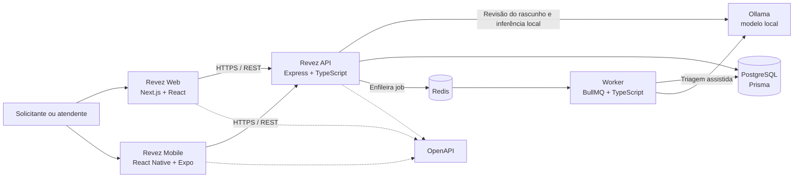
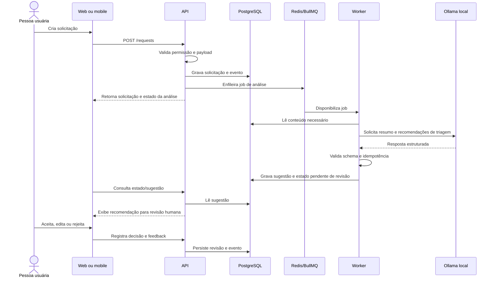

# Arquitetura e diagramas do Revez

**Status:** direção técnica aprovada; detalhes de domínio pendentes.

## Princípios

- Web e mobile são novos clientes e compartilham API, contrato e fonte de dados.
- Keycloak provê SSO e gerencia usuários/grupos; a API aplica autorização com base na identidade e nos papéis autenticados.
- API Node.js/TypeScript/Express em monólito modular; worker BullMQ como processo separado.
- PostgreSQL guarda dados transacionais e histórico; Redis sustenta a fila de jobs.
- Ollama é o provedor local preferido de LLM, executado em container; falha ou indisponibilidade da inferência não deve impedir operações básicas.
- A revisão de rascunho é uma chamada explícita à API antes da criação; a triagem posterior à criação é assíncrona via BullMQ/Worker.
- Web, API, PostgreSQL, Redis, Keycloak e Ollama devem poder compor o ambiente Docker Compose local; o Worker será adicionado quando implementado.
- TanStack Query gerencia estado remoto; Zustand é reservado a estado global de interface que realmente atravesse telas; demais estados ficam locais.
- OpenAPI é o contrato de integração; Docker Compose define dependências locais.
- Observabilidade técnica deve correlacionar logs, métricas e traces dos serviços sem registrar credenciais ou conteúdo sensível; sua stack ainda é uma proposta.
- Não introduzir microserviços ou plataforma de streaming no MVP.

## Contexto e componentes



### Limites entre componentes

| Componente | Responsabilidade | Não deve duplicar |
|---|---|---|
| Web | Operação da fila, detalhes, formulários, revisão da IA e métricas aprovadas | Regras de negócio ou acesso direto ao banco |
| Mobile | Consulta e ações mobile aprovadas | Regras de negócio ou persistência no servidor |
| API | Autorização, validação, regras, contrato e persistência transacional | Execução demorada de IA dentro da requisição HTTP |
| Redis/BullMQ | Estado e distribuição de jobs assíncronos | Fonte permanente dos dados do domínio |
| Worker | Resumo/classificação/embeddings e gravação dos resultados | Decisão operacional autônoma |
| PostgreSQL | Fonte da verdade para solicitações, histórico e resultados | Cache efêmero da fila |
| Ollama | Inferência local de LLM para revisão de rascunho e triagem | Fonte de dados ou decisor autônomo |

## Ambiente Docker Compose local (planejado)

O ambiente local deve executar Web, API, PostgreSQL, Redis, Keycloak e Ollama em serviços separados; Worker será acrescentado quando sua implementação começar. Modelos do Ollama ficam em volume persistente para evitar downloads repetidos. O consumo de recursos depende do modelo e do hardware, e a licença do modelo precisa ser verificada.

O navegador não resolve nomes de serviço do Compose. Portanto, o Web client deve chamar a API por uma URL publicada no host (ou por um proxy Web explicitamente configurado); a API usa o nome interno do serviço Ollama, por exemplo `http://ollama:11434`. A API do Ollama deve permanecer na rede interna do Compose ou ligada apenas ao loopback local, sem exposição pública desprotegida. Mobile/emuladores podem exigir configuração própria do endereço publicado da API.

Esta é uma direção de arquitetura, não o estado atual do `compose.yaml`; arquivos e serviços só serão alterados em uma etapa de implementação autorizada.

## Observabilidade técnica (planejada)

Observabilidade responde se os componentes estão disponíveis, lentos ou falhando. Ela é distinta das métricas de produto e do histórico de domínio:

- **Logs:** eventos estruturados, inicialmente em JSON, com identificador de requisição e contexto de trace quando disponível. Não incluir tokens, corpos completos de solicitações ou dados pessoais desnecessários.
- **Métricas:** começar pela API com taxa de requisições, erros e latência (RED), além de estado das dependências. Quando o worker existir, adicionar duração, falhas, retentativas e profundidade/idade das filas.
- **Traces:** seguir uma operação entre cliente, API, banco e, futuramente, worker/fila, usando propagação de contexto. Dados sensíveis não devem ser incluídos em atributos de spans.
- **Saúde:** separar liveness (processo ativo) de readiness (capaz de atender, considerando dependências necessárias).
- **Visualização:** proposta de OpenTelemetry como padrão de instrumentação, Prometheus para coleta de métricas e Grafana para dashboards locais via Docker Compose. Backend de traces, armazenamento de logs, política de retenção e alertas ficam para decisão posterior.

Adotar por etapas: instrumentar a API e validar o fluxo local; incluir propagação e métricas do worker quando sua implementação começar; só então definir dashboards operacionais, alertas e monitoramento de frontend/produção. Não usar rótulos de alta cardinalidade, como IDs de usuário, solicitação ou requisição, em métricas.

## Fluxo assíncrono de sugestão de IA

A revisão do rascunho ocorre sob demanda pela API antes do `POST /requests`; ela não persiste o rascunho nem bloqueia sua criação. A sequência abaixo descreve apenas a triagem assíncrona posterior:



## Dados e IA

`RequestEvent` funciona como histórico de domínio para auditoria e consultas operacionais. `AiSuggestion` guarda tipo, estado, referência à solicitação, versão do provedor/configuração, resultado e revisão humana. O schema final deve minimizar dados e ser validado antes de persistir. Erros do worker devem aparecer como estado recuperável e não apagar dados originais.

PostgreSQL permanece suficiente para o início. pgvector pode armazenar embeddings e resolver busca de itens semelhantes dentro do mesmo banco; essa etapa depende da decisão de produto e da disponibilidade de exemplos para avaliar relevância. Indicadores devem nascer de perguntas operacionais definidas, não de coleta indiscriminada.

## Organização do código proposta

```text
apps/
  web/
  mobile/
  api/
  worker/
packages/
  contracts/       # OpenAPI/tipos compartilhados, se reduzir divergência
  validation/      # schemas compartilhados apenas quando compatíveis
```

Usar pnpm workspaces. O worker pode compartilhar domínio e schemas com a API, mas executar em processo próprio. Não compartilhar componentes de UI entre Next.js e React Native. Turborepo fica para quando builds e cache justificarem a complexidade.

## Padrões de implementação

- Módulos por domínio/funcionalidade e casos de uso para regras relevantes.
- Controllers finos; DTO/schema validado na fronteira HTTP.
- Repositórios ou adaptadores quando isolarem persistência/integração com benefício verificável.
- Interface pequena para provedor de IA; SDK e prompts ficam encapsulados.
- Saídas de IA com formato estruturado, validação e revisão humana.
- Jobs idempotentes, com retentativas limitadas, timeout e estado rastreável.
- Tratar dados remotos com TanStack Query; UI global com Zustand somente se necessário.

## Desenvolvimento local

O ambiente planejado em Docker Compose inclui Web, API, PostgreSQL, Redis, Keycloak e Ollama; Worker entra quando implementado. Mobile pode rodar no host para facilitar o uso de emuladores. A URL da API usada pelo navegador deve ser publicada no host; serviços containerizados usam nomes DNS internos para chamadas entre containers. Configuração de ambiente deve ser documentada; `.env` real não deve ser commitado. CI valida lint, tipos, testes e builds.

## Decisões arquiteturais ainda abertas

- Protocolo SSO, claims de token, nome do grupo de Operadores e configuração do provedor corporativo no Keycloak.
- Limite técnico da empresa e autorização para ações ainda não definidas, como edição por Solicitantes e exclusão.
- Modelo Ollama, requisitos de recursos/licença e tratamento quando conteúdo proibido for detectado.
- Eventual provedor hospedado, incluindo retenção, cotas, custo e política de dados.
- Quando enfileirar análise e como reprocessar falhas manualmente.
- Métricas operacionais e avaliação de qualidade.
- Se busca semântica com pgvector é necessária para o MVP ou fase seguinte.
