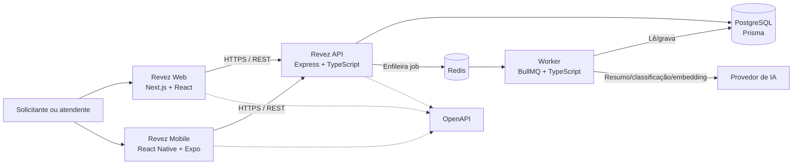
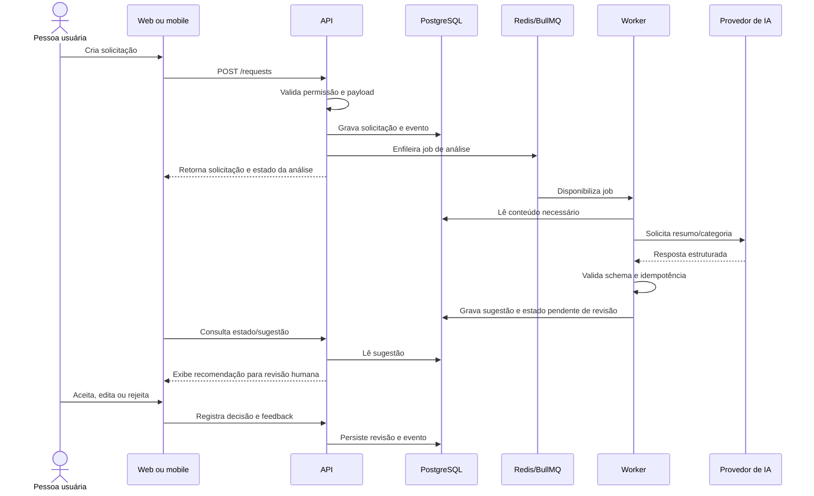

# Arquitetura e diagramas do Revez

**Status:** direção técnica aprovada; detalhes de domínio pendentes.

## Princípios

- Web e mobile são novos clientes e compartilham API, contrato e fonte de dados.
- API Node.js/TypeScript/Express em monólito modular; worker BullMQ como processo separado.
- PostgreSQL guarda dados transacionais e histórico; Redis sustenta a fila de jobs.
- IA é uma dependência externa opcional para o fluxo transacional: falha do provedor não deve impedir operações básicas.
- TanStack Query gerencia estado remoto; Zustand é reservado a estado global de interface que realmente atravesse telas; demais estados ficam locais.
- OpenAPI é o contrato de integração; Docker Compose define dependências locais.
- Não introduzir microserviços ou plataforma de streaming no MVP.

## Contexto e componentes



### Limites entre componentes

| Componente | Responsabilidade | Não deve duplicar |
|---|---|---|
| Web | Operação da fila, detalhes, formulários, revisão da IA e métricas aprovadas | Regras de negócio ou acesso direto ao banco |
| Mobile | Consulta e ações mobile aprovadas | Regras de negócio ou persistência no servidor |
| API | Autorização, validação, regras, contrato e persistência transacional | Execução demorada de IA dentro da requisição HTTP |
| Redis/BullMQ | Estado e distribuição de jobs assíncronos | Fonte permanente dos dados do domínio |
| Worker | Resumo/classificação/embeddings e gravação dos resultados | Decisão operacional autônoma |
| PostgreSQL | Fonte da verdade para solicitações, histórico e resultados | Cache efêmero da fila |

## Fluxo assíncrono de sugestão de IA



## Dados e IA

`RequestEvent` funciona como histórico de domínio para auditoria e consultas operacionais. `AiSuggestion` guarda tipo, estado, referência à solicitação, versão do provedor/configuração, resultado e revisão humana. O schema final deve minimizar dados e ser validado antes de persistir. Erros do worker devem aparecer como estado recuperável e não apagar dados originais.

PostgreSQL permanece suficiente para o início. pgvector pode armazenar embeddings e resolver busca de itens semelhantes dentro do mesmo banco; essa etapa depende da decisão de produto e da disponibilidade de exemplos para avaliar relevância. Indicadores devem nascer de perguntas operacionais definidas, não de coleta indiscriminada.

## Organização do código proposta

```text
apps/
  web/
  mobile/
  api/
  worker/
packages/
  contracts/       # OpenAPI/tipos compartilhados, se reduzir divergência
  validation/      # schemas compartilhados apenas quando compatíveis
```

Usar pnpm workspaces. O worker pode compartilhar domínio e schemas com a API, mas executar em processo próprio. Não compartilhar componentes de UI entre Next.js e React Native. Turborepo fica para quando builds e cache justificarem a complexidade.

## Padrões de implementação

- Módulos por domínio/funcionalidade e casos de uso para regras relevantes.
- Controllers finos; DTO/schema validado na fronteira HTTP.
- Repositórios ou adaptadores quando isolarem persistência/integração com benefício verificável.
- Interface pequena para provedor de IA; SDK e prompts ficam encapsulados.
- Saídas de IA com formato estruturado, validação e revisão humana.
- Jobs idempotentes, com retentativas limitadas, timeout e estado rastreável.
- Tratar dados remotos com TanStack Query; UI global com Zustand somente se necessário.

## Desenvolvimento local

Docker Compose sobe PostgreSQL e Redis e, quando útil, API/worker. Next.js e Expo podem rodar no host para facilitar hot reload e uso de emuladores. Configuração de ambiente deve ser documentada; `.env` real não deve ser commitado. CI valida lint, tipos, testes e builds.

## Decisões arquiteturais ainda abertas

- Papéis, autenticação e estratégia de sessão.
- Provedor de IA, dados enviados, retenção e limites de custo.
- Quando enfileirar análise e como reprocessar falhas manualmente.
- Campos e transições de solicitação e comentários.
- Métricas operacionais e avaliação de qualidade.
- Se busca semântica com pgvector é necessária para o MVP ou fase seguinte.
