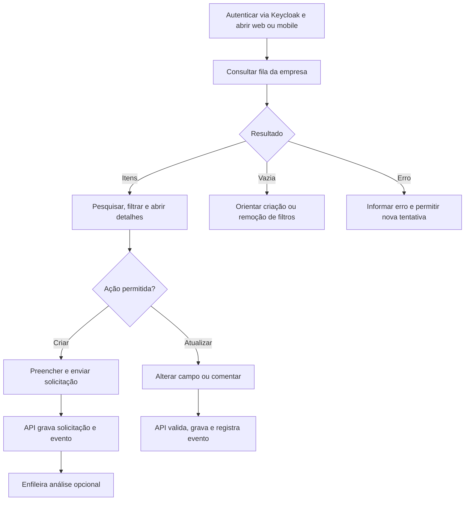

# Fluxos de usuário

**Status:** jornadas propostas; SSO e permissões iniciais definidos em `02-requisitos.md`.

## Fluxo principal de solicitação

## Fluxo de sugestão de IA

1. Após criação ou ação explícita, a API informa que a análise está pendente e enfileira o job.
2. O worker usa título e descrição para sugerir resumo/categoria e grava o resultado ou estado de falha.
3. A interface atualiza o estado da análise e apresenta a sugestão com indicação de que foi gerada por IA.
4. A pessoa revisa e aceita, edita ou rejeita a sugestão.
5. A API guarda a revisão como evento para histórico e avaliação.

Nenhum campo da solicitação é alterado automaticamente com base no resultado do modelo. Se o serviço estiver indisponível, a solicitação continua disponível e a pessoa pode seguir o fluxo normal.

## Estados que a interface deve comunicar

- **Análise pendente:** job aguardando worker.
- **Em processamento:** análise iniciada; não bloquear o restante da tela.
- **Sugestão pronta:** resultado disponível para revisão.
- **Falha:** explicar que a análise não foi concluída e oferecer nova tentativa se permitido.
- **Revisada:** registrar se foi aceita, editada ou rejeitada.

## Jornada para criar e acompanhar

1. Autenticar via Keycloak, abrir o formulário de criação e preencher os sete campos obrigatórios definidos em `02-requisitos.md`.
2. Ver validação por campo e enviar.
3. Receber confirmação da API sem esperar resposta de IA.
4. Consultar item em web ou mobile conforme permissões.
5. Ler histórico, comentários e sugestão (se disponível).
6. Executar ação autorizada e confirmar atualização persistida.

## Navegação e decisões pendentes

- Definir o protocolo SSO, as claims do token e o nome do grupo de Operadores no Keycloak.
- Delimitar tecnicamente a empresa dos dados e decidir edição por Solicitantes e exclusão.
- Decidir se análise ocorre automaticamente ou por ação da pessoa.
- Definir se usuário pode pedir nova análise e como limitar repetições/custos.
- Definir ações que exigem confirmação e se alterações podem ser desfeitas.
- Definir comportamento de retomada do formulário em erro e conectividade limitada.
