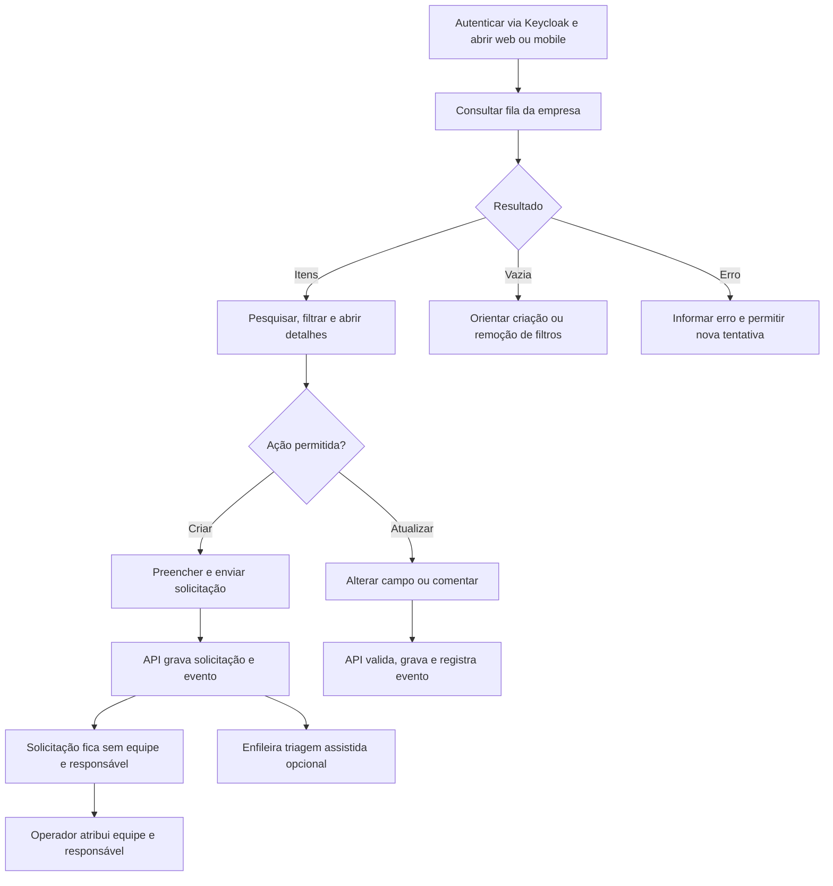

# Fluxos de usuário

**Status:** jornadas propostas; SSO e permissões iniciais definidos em `02-requisitos.md`.

## Fluxo principal de solicitação

## Fluxo de sugestão de IA

### Revisão do rascunho pelo Solicitante

1. Enquanto preenche título e descrição, o Solicitante pode acionar **Revisar com IA**.
2. A IA aponta informações possivelmente ausentes e sugere perguntas que o Solicitante pode responder, além de possíveis melhorias no texto.
3. O Solicitante decide se aplica, adapta ou ignora as sugestões; não precisa aceitá-las para enviar.
4. A análise ou uma falha da IA nunca bloqueia o envio da solicitação.

### Apoio à triagem do Operador

1. Após a criação, a solicitação é salva e confirmada sem esperar a IA; uma análise de triagem é enfileirada separadamente.
2. O worker usa título e descrição, junto dos catálogos e regras aprovados, para sugerir resumo e recomendar categoria, prioridade e equipe.
3. A interface apresenta o resultado identificado como sugestão de IA e comunica estados pendente, em processamento, pronto ou falha.
4. O Operador revisa as recomendações e pode aceitá-las, editá-las ou rejeitá-las. Atribuição e alterações só são persistidas após ação explícita do Operador.
5. A API registra eventos estruturados de geração e revisão para histórico e avaliação, sem guardar conteúdo desnecessário.

Em nenhuma etapa a IA altera campos ou envia perguntas/comentários automaticamente. A análise prévia serve para ajudar o próprio Solicitante a complementar o rascunho; as recomendações posteriores apoiam, mas não substituem, a decisão do Operador. Se o serviço estiver indisponível, os fluxos normais continuam funcionando.

## Estados que a interface deve comunicar

- **Revisão do rascunho:** ação opcional em andamento, resultado pronto ou falha; nenhum estado impede o envio.
- **Triagem pendente/em processamento:** job aguardando ou executando no worker, sem bloquear a solicitação.
- **Sugestão pronta:** resultado disponível para revisão do Operador.
- **Falha:** explicar que a análise não foi concluída e oferecer nova tentativa se permitido.
- **Revisada:** registrar se a recomendação foi aceita, editada ou rejeitada.

## Jornada para criar e acompanhar

1. Autenticar via Keycloak, abrir o formulário de criação e preencher os cinco campos obrigatórios definidos em `02-requisitos.md`. O Solicitante é obtido da identidade autenticada.
2. Opcionalmente acionar **Revisar com IA**, considerar as perguntas de esclarecimento e editar o rascunho; essa revisão não é obrigatória.
3. Ver validação por campo e enviar.
4. Receber confirmação da API sem esperar resposta da triagem; a solicitação começa sem equipe e responsável.
5. Um Operador consulta as sugestões de resumo, categoria, prioridade e equipe, e decide se as aplica.
6. Consultar o item em web ou mobile conforme permissões.
7. Ler histórico, comentários e estado da análise.
8. Executar ação autorizada e confirmar atualização persistida.

## Navegação e decisões pendentes

- Definir o protocolo SSO, as claims do token e o nome do grupo de Operadores no Keycloak.
- Delimitar tecnicamente a empresa dos dados e decidir edição por Solicitantes e exclusão.
- Decidir se análise ocorre automaticamente ou por ação da pessoa.
- Definir se usuário pode pedir nova análise e como limitar repetições/custos.
- Definir ações que exigem confirmação e se alterações podem ser desfeitas.
- Definir comportamento de retomada do formulário em erro e conectividade limitada.
